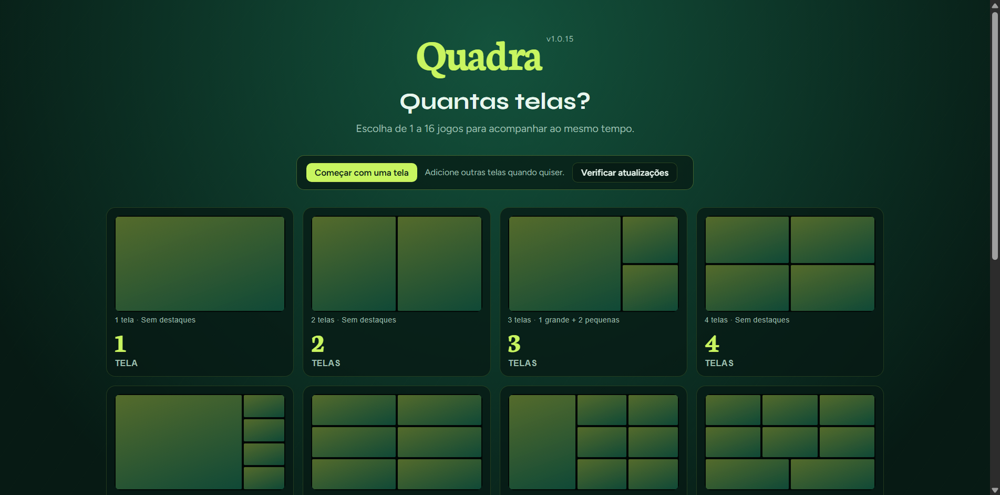

# Quadra — Multi-view

App desktop Windows (Electron) para assistir de 1 a 18 páginas ao mesmo tempo numa só janela. Cada painel é uma `WebContentsView` completa do Chromium, então até sites com `X-Frame-Options` abrem normalmente.



## Como rodar

```bash
npm ci               # dependências + runtime ECS da Castlabs
npm run dev          # desenvolvimento
npm run build        # build em out/
npm run dist:release # instalador NSIS em release/
```

## Como usar

1. Escolha quantas telas quer (1 a 18) ou **Começar com uma tela**.
2. Cole uma URL em cada painel e clique em **Abrir** (ou **Abrir todos**).
3. **+ Adicionar tela** cria um painel; a lixeira remove. O layout se reorganiza sozinho.
4. **Organizar** escolhe a composição, os destaques e a posição deles (**Aplicar** / **Cancelar** ou Esc).
5. Outros controles: **Sem destaques**, **Organizar automaticamente**, **Mostrar/Ocultar nomes dos jogos**, **Desfazer**, **Telas**, **Voltar** (canto superior esquerdo), **Tela Cheia**. Em cada painel: ✎ editar URL, ↻ recarregar, ⏱ atraso (365Scores), 🔔 alertas do painel, 🗑 remover.

### BLL

- Botão **BLL** no painel: login uma vez (sessão persistente `persist:quadra`) e escolha o jogo; os próximos vão para a próxima tela vazia.
- **Abrir vários jogos da BLL** (tela inicial ou menu **⋯**): lista os jogos ao vivo lidos da home da BLL numa página oculta (só leitura, mesmo login), agrupados por liga (país + liga em ordem alfabética, jogos por horário, fase ao lado). Jogos de basquete aparecem com 🏀 e de futebol americano com 🏈. Na tela inicial cria uma tela por jogo; com a grade aberta, preenche as vazias e cria as que faltarem (até 18). Jogos já abertos são pulados; previstos só aparecem quando começam. **Desfazer** volta.
- **Modo Auto** (tela inicial ou menu **⋯**; ponto verde no **⋯** quando ligado): relê a lista da BLL a cada minuto e abre numa tela cada jogo de futebol que fica ao vivo numa competição escolhida. Cada competição fica em **Todos os jogos**, **Só times principais** ou **Desligada** (padrão: Brasileirão, Copa do Brasil, Supercopa do Brasil, competições da UEFA e as 5 grandes ligas com todos os jogos; copas nacionais europeias só com os times principais). Dá para somar competições como aparecem na BLL ("Portugal, Liga Portugal") e editar os times principais (outros nomes separados por `/`); a opção "em qualquer competição" abre também amistosos etc. dos times principais. Preenche telas vazias e cria telas até 18; com a grade cheia, jogo de time principal entra no lugar do jogo mais antigo aberto pelo modo Auto sem time principal (os outros esperam tela livre). Painéis abertos por você nunca são trocados; jogo que você fechar ou trocar não volta. Com o organizador, um arrasto, um diálogo ou um destaque de gol na tela, espera e tenta de novo em 5 s. Ligar abre também os jogos que já estão ao vivo. Listas salvas no perfil (`localStorage`); ligado/desligado vale só até fechar o app. Times casam pelo nome inteiro (Milan ≠ Inter Milan; feminino, sub-XX e reservas ficam fora).

### YouTube

- **Abrir jogos ao vivo do YouTube**: usa a YouTube Data API v3 só nos canais de uma lista (padrão: CazéTV, CazéTV 2, ge tv, ESPN Brasil, Canal GOAT, TNT Sports Brasil, SBT Sports, Paulistão, CONMEBOL, N Sports; **Canais…** adiciona por @/link, remove ou restaura, até 50). Lê os 50 últimos uploads de cada canal e mantém as lives com confronto no título (`Time A x Time B`), sem reacts, pré/pós-jogo, resenhas, reprises, videogame ou outros esportes (exceto NFL/NBA). Ordem por espectadores; cerca de 2 unidades de cota por canal, resultado reaproveitado por 1 min.
- **Chave da API:** o instalador oficial embute a chave do projeto (secret `QUADRA_YOUTUBE_API_KEY` do GitHub → `QUADRA_BUILTIN_YOUTUBE_API_KEY` no build; não está no código). Builds locais vêm sem chave. Chave própria: copie `.env.example` para `.env` e preencha `QUADRA_YOUTUBE_API_KEY=` (no app instalado, ao lado do `Quadra.exe` ou na pasta de dados); ela tem prioridade. A cota de 10.000/dia da chave embutida é compartilhada.
- **Só o vídeo:** links `watch`/`live` mostram só o player (sem cabeçalho, chat ou sugestões). Anúncios são pulados/acelerados e domínios de anúncio bloqueados na sessão do app — melhor esforço (anúncios no próprio stream não dá para separar; o YouTube pode mudar a página).

### Layout

- Os tamanhos maximizam a área de vídeo 16:9 sem cortar a imagem; players esportivos ganham barras pretas quando preciso.
- Destaque (★) leva o jogo ao espaço grande; dois destaques mudam para uma composição que comporte dois. Redimensionar recalcula preservando destaques. A barra de controles fica visível também em tela cheia.
- **Nome do jogo:** com `Time A x Time B` no título (ou nomes do feed), o painel mostra o nome inteiro dos times, nunca sigla: na faixa preta de baixo/cima (fonte encolhe; duas linhas se preciso) ou numa legenda em degradê na base do vídeo (até 36 px). Emojis de som/esporte do título são removidos. O **×** (aparece com o mouse sobre os nomes) oculta aquele painel; **Abrir** restaura; o menu **⋯** oculta todos.

### Alertas de lances

- **Fontes:** jogos BLL usam o feed William Hill numa janela oculta, sem a sessão BLL. Lives do YouTube e jogos BLL sem William Hill usam o 365Scores (abaixo).
- **Gol, Pênalti, Cartão vermelho, Cartão amarelo** (desligado por padrão) e **VAR** (só 365Scores) tocam som e mostram borda com selo (gol 45 s, demais 12 s). Cada tipo tem o seu som, escolhido ao lado dele em **Alertar em** (33 opções; clicar já toca). O 🔔 desliga os alertas de um painel. Com todas as telas mudas, o app mantém a saída de áudio acordada para o alerta tocar.
- **Destaque automático:** com 3+ telas o jogo do gol vira destaque (15 s a 3 min, padrão 45 s). Gols acumulam até o limite da composição (sai o mais antigo); quando dois destaques ficam bem maiores que um, um painel companheiro cresce junto. **Fixar** mantém, **Voltar** desfaz; mudança manual de layout cancela o modo.
- **Placar:** o rótulo mostra o placar do feed; **Placar no painel** atrasa cada mudança 10–60 s ou esconde (padrão: na hora; o placar inicial aparece sem atraso). No futebol os números piscam; no basquete só rolam.
- **Escudos:** do CDN público do 365Scores (`imagecache.365scores.com`; override `QUADRA_365SCORES_IMAGE_URL`), nunca atrasam o rótulo; sem escudo, fica só o nome. Nos jogos William Hill os nomes são procurados na lista do 365Scores. Cache só em memória (500).
- **Fechar no fim do jogo:** William Hill `GAME_FINISHED` (ou `END_OF_MATCH` se o período não puder ser lido) ou 365Scores `statusGroup` 4 ou a lista da BLL (`situacao` 3 → 4, "Encerrado"; relida a cada 1 min enquanto houver player BLL aberto, vale para qualquer esporte) → o primeiro que avisar dispara **Fim de jogo · fecha em N s** + **Manter aberto**. Tempo: na hora, 30 s, 1 min (padrão), 2 min, 5 min ou não fechar; conta só depois do atraso do placar/painel. Não fecha jogo que já tinha acabado, a última tela, nem com organizador/arrasto/diálogo aberto. **Desfazer** traz de volta; **Manter aberto** vale também para o aviso que chegar depois por outra fonte. Basquete só fecha pela lista da BLL.
- **Monitor de lances** (tela inicial ou **⋯**) mostra os logs com a fonte de cada linha (**William Hill** / **365Scores API**); também em `logs/` no perfil do app.
- Preferências de som e alertas ficam no `localStorage`; URLs e layout só em memória.

#### 365Scores (YouTube e BLL sem William Hill)

- API web não documentada (`webws.365scores.com`), sem login nem cookies, só pelo processo principal. Matching por nomes (ignora acentos e FC/EC; apelidos Galo/Verdão, sufixos MG/PR, sub-XX/feminino/reservas) contra os jogos ao vivo e a agenda do dia (até 4 h inclui ontem), cache de 30 s. Claro → vinculado; ambíguo → **Qual jogo é este?** (até 3 + Nenhum); nenhum → retenta a cada 2 min, até 5 vezes. Nomes só com palavras genéricas (Atlético, Real…) viram pergunta.
- Detalhe a cada 3 s até o fim do jogo. Consulta travada: desiste em 4 s e tenta na hora 3 vezes, depois 3/6/12 s (teto 15 s); erro HTTP espera até 60 s.
- Lances: gols (pênalti, contra), cartões (2º amarelo), pênalti perdido, VAR de gol anulado. A **narração ao vivo** (`pbpgenerator.365scores.com`, a cada 5 s) traz pênalti marcado e decisões do VAR. O placar é a referência: gol sem evento em 9 s alerta pelo placar, e o evento atrasado não repete. Ligas "só placar": gols pela mudança do placar, vermelhos pela contagem (`/web/games/?games=<id>`), placar que diminui vira VAR. Só VAR de gol anulado solta o destaque automático.
- **Contra spoiler:** nos painéis 365Scores o atraso vale também para alertas e destaque; botão **⏱ N s** por painel (padrão / na hora / 10–120 s, só em memória). BLL com William Hill segue na hora.
- **BLL sem William Hill:** sem `williamHillId`, busca pelo `evento.nome` (ou pelo título da página após 60 s); se o id aparecer depois, o William Hill assume.
- **Basquete BLL:** a BLL marca o esporte com emoji no nome (🏀; futebol sem emoji) e o basquete vem sem `williamHillId`. A busca usa `sports=2`, e uma palavra distintiva (4+ letras) em comum basta por time (os nomes trazem patrocinador). Só nomes, escudos e placar: sem alertas; fecha no fim só pelo "Encerrado" da BLL.
- **Futebol americano BLL (NFL, universitário):** jogo com 🏈 no nome vai sempre para o 365Scores (`sports=6`), mesmo se a BLL der um `williamHillId` (o scanner William Hill só entende futebol; o Monitor registra se o id veio). Nomes, escudos, placar e alertas **Touchdown** (com passe/corrida e quarto) e **Field goal** (tipos 16 e 17 do 365Scores). Placar como reserva: salto de 6+ pontos é touchdown e de 3+ field goal, depois de 9 s sem o evento (na hora em liga sem eventos); ponto extra, conversão de 2 e safety não alertam. Touchdown destaca o painel como o gol. Fecha no fim só pelo "Encerrado" da BLL.
- Limites: API não oficial pode mudar ou bloquear; pênalti/VAR dependem da narração (nem todo jogo tem); ainda não validado ao vivo no app.

### Sessão e dados

URLs e layout ficam só em memória. Só a BLL usa sessão persistente. Credenciais, cookies, tokens e licenças não são coletados.

## Especificações técnicas

### DRM (Widevine / Disney+)

- Runtime **Castlabs ECS `v44.1.0+wvcus`**; o app espera `components.whenReady()` e usa o user-agent real do Chromium. Se o Widevine falhar, avisa e segue sem conteúdo protegido.
- Release exige assinatura VMP com `castlabs-evs==1.3.2` (`electron/after-sign.cjs` assina e verifica; falha interrompe o build). `npm run dist:drm-poc` gera build de teste com assinatura de desenvolvimento.
- EVS/VMP **não** substitui Authenticode: sem certificado, o instalador não é assinado pelo Windows.
- `npm run test:ecs` confere versão/origem do ECS e `.sig`; `npm run test:drm-diagnostic` só prova EME/Widevine local. Detalhes: [docs/disney-plus-drm.md](docs/disney-plus-drm.md).

### Atualizações

- Só o app empacotado verifica o release estável do GitHub (`electron-updater`) ao abrir e pergunta antes de baixar e de reiniciar. **Verificar atualizações** força a busca. Valida HTTPS e SHA-512 do `latest.yml`.
- **Novidades:** na primeira abertura de cada versão aparece a lista do que mudou, com o histórico abaixo; o botão **Novidades** reabre. As notas ficam em `src/release-notes.ts` — a cada release, adicione a entrada no topo de `RELEASES` (`tests/release-notes.test.ts` falha sem ela).

### CI e release

- `windows-pr-checks.yml`: em cada PR, instalação limpa, ECS, testes e smokes.
- `windows-release.yml`: em tag `v*`, confere tag × `package.json`, assina com EVS, valida metadata/blockmap/NSIS e cria um release **draft**.

Para publicar: merge → tag nova no commit integrado (nunca mover tags públicas) → baixar o draft e conferir `release-verification.json` e hashes → testar Disney+ no instalador → publicar como `latest`.

### Testes

```bash
npm test               # unitários
npm run typecheck
npm run test:renderer  # interface
npm run test:toolbar   # app real com vídeos (capturas em artifacts/toolbar-checks/)
npm run test:app       # integração
npm run test:close     # fechamento
npm run test:packaged  # app empacotado
```

Cobrem 1 a 18 telas, composições e destaques (142 combinações), adição/remoção, edição, várias páginas, `X-Frame-Options`, encaixe de players (16:9, 4:3, 3:4, 16:4), tela cheia e redimensionamento.

### Limitações conhecidas

Validação de URL, mensagens de erro de navegação, reabertura da mesma URL e perda de parâmetros em alguns links do YouTube ainda não foram tratados.
